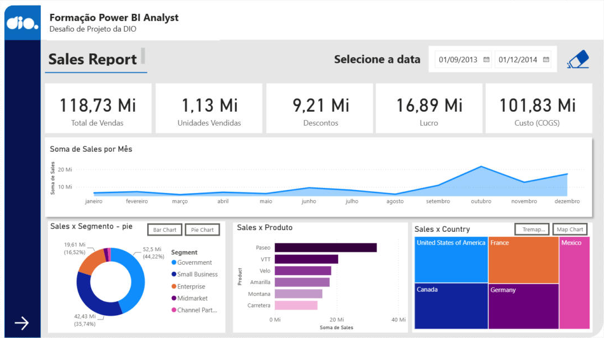
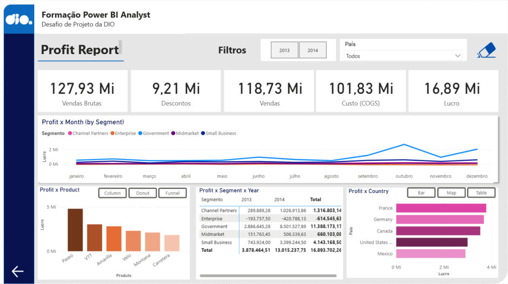
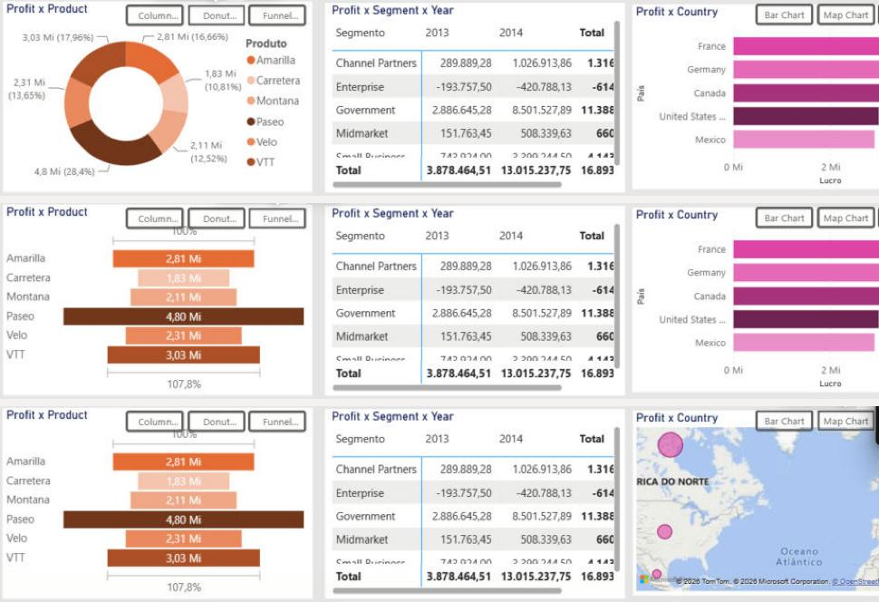

# Desafio de Projeto DIO — Relatório Gerencial de Vendas e Lucro no Power BI

Segundo desafio de projeto da formação **Power BI Analyst** da [DIO](https://www.dio.me/): um relatório mais elaborado sobre a base de exemplo **Financial Sample**, com estrutura definida por objetos de layout, botões de navegação entre páginas, segmentadores de dados, botão com imagem e indicadores (bookmarks) que alternam visuais sobre um mesmo assunto.

## Arquivos

| Arquivo | Conteúdo |
|---|---|
| `relatorio_criativo_financial_sample.pbix` | Relatório do Power BI com as duas páginas |
| `prints/` | Imagens das páginas e dos estados dos indicadores |

## Estrutura do relatório

As duas páginas seguem a mesma estrutura: fundo arredondado, barra lateral com o logo da DIO, faixa de título, título da página com sublinhado, uma linha de cartões, um painel central largo e três painéis na parte de baixo. A seta na barra lateral leva de uma página para a outra.

### Página 1 — Sales Report

Página construída seguindo o passo a passo das aulas:

- Cartões: Total de Vendas, Unidades Vendidas, Descontos, Lucro e Custo (COGS)
- Segmentador de data (intervalo) com botão de imagem (borracha) que limpa a seleção por meio de um indicador
- Vendas por mês (gráfico de área)
- Vendas x Segmento: botões **Bar Chart** e **Pie Chart** alternam entre barras e rosca
- Vendas x Produto (barras)
- Vendas x Country: botões **Tremap Chart** e **Map Chart** alternam entre treemap e mapa
- Seta para a página 2

Única alteração em relação ao material do curso: o quarto cartão repetia "Descontos" e passou a mostrar o **Lucro**.

### Página 2 — Profit Report

Página criada do zero, com foco em lucro:

- **Filtros:** segmentador de ano em formato de botões (2013 / 2014), segmentador de país em lista suspensa e botão com imagem (borracha) ligado ao indicador *Limpar filtros*, que desmarca os dois segmentadores
- **Cartões** na ordem do resultado: Vendas Brutas → Descontos → Vendas → Custo (COGS) → Lucro
- **Profit x Month (by Segment):** gráfico de linhas com uma linha por segmento
- **Profit x Product:** botões **Column**, **Donut** e **Funnel** alternam três visuais do mesmo assunto
- **Profit x Segment x Year:** matriz com segmentos nas linhas, anos nas colunas e totais
- **Profit x Country:** botões **Bar**, **Map** e **Table** alternam três visuais do mesmo assunto
- Seta de volta para a página 1

## Como os indicadores funcionam

Cada grupo de visuais alternáveis (por exemplo, *Profit x Produto*) tem os três visuais sobrepostos na mesma posição. Para cada botão existe um indicador criado com a opção **Visuais selecionados**, que guarda apenas a visibilidade dos visuais daquele grupo: o visual escolhido fica visível e os outros dois ficam ocultos. Assim, trocar o gráfico de produto não interfere no gráfico de país, e os filtros da página continuam valendo.

O indicador *Limpar filtros* também é de visuais selecionados, aplicado apenas aos dois segmentadores, e foi salvo com os dois sem seleção.

No Power BI Desktop os botões são acionados com **Ctrl + clique**; no Power BI Service, com um clique simples.

## Dados

A **Financial Sample** é uma base de exemplo da Microsoft com 700 registros de vendas por segmento, país, produto e data. O segmento Enterprise tem lucro negativo, o que aparece na matriz e na linha abaixo de zero no gráfico de lucro por mês.

## Como abrir

1. Baixe o arquivo `relatorio_criativo_financial_sample.pbix`.
2. Abra no Power BI Desktop.
3. Se o mapa aparecer desabilitado, vá em **Arquivo > Opções e configurações > Opções > Global > Segurança** e marque **"Usar visuais de Mapa e Mapa Coroplético"**.

## Referência

Repositório do curso, com os dados e os arquivos das aulas: [julianazanelatto/power_bi_analyst](https://github.com/julianazanelatto/power_bi_analyst)
